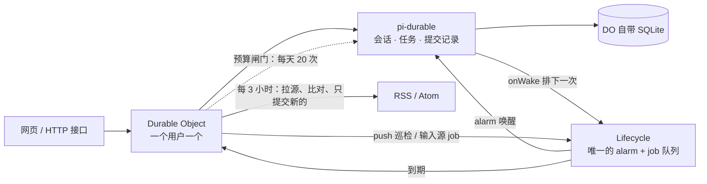

# memex

**一个人用的 agent，不该需要一台服务器。**

一个跑在 Cloudflare 上的个人 agent 骨架：一个 Durable Object 就是一个人的 agent。没有 VPS，没有 Postgres，没有 Redis，没有容器。

---

## 它只做一件事

> **发一条消息，页面可以立刻关掉，它做完了答案还在等你。**
>
> **再给它一个源，它会自己去看看有什么新的，值得看的才放进收件箱。**

整个仓库围着这两句转。十二个接口，一千九百行 —— 其中三百多行是那个读网页的工具，大部分用在编码和清洗上；另三百多行是订阅源的解析与预算。

这不是功能少，是判断：**「不丢事」是这类 agent 唯一无法被别的东西替代的能力。** 换个更强的模型、换个更漂亮的界面都不影响它；但只要你得盯着屏幕等它答完，它就不是一个能替你干活的 agent，只是一个更慢的搜索框。

其余的一切——记忆、主动找你、读你的邮件、改你的代码——都得先有这一条才谈得上。

第二句是第一句的延伸，不是新功能：**「不丢」不只是「别把我说的事弄丢」，也包括「别让该我知道的事悄悄过去」。** 而它之所以还站得住，是因为输入源没有引入任何新的执行机制——拉源是廉价的，判断是否新的也是廉价的，只有真的新的东西才变成一条任务，走的是同一条路。

## 为什么在 Cloudflare 上做

先看清楚这类东西现在怎么部署。三个同类：

| | 你需要准备什么 | 每月 | 谁来运维 |
|---|---|---|---|
| Moltis / OpenClaw | 一台 VPS、Docker、沙箱 | $5–20 | 你 |
| vercel-labs/personal-agent-template | Postgres + 一个认证服务 | $0–20 | 你 |
| **memex** | 一个 Cloudflare 账号 | **$0** | 没人 |

这不是「更便宜」的营销话术，是量级差。一个人一天几十条消息，落在免费额度里长这样：

| 免费额度（每天，SQLite 版 DO） | 一个人用掉多少 |
|---|---|
| 10 万次 DO 请求 | 几十次 |
| 13,000 GB-s 活跃时长（≈ 一个 128MB 的 DO 连着跑 29 小时） | 几分钟 |
| 5 GB 存储、10 万行写入 | 几 MB、几十行 |

千分之几。**真正花钱的是 token，不是基础设施。**

## 这个选择的代价

零运维不是白来的。Workers 上没有文件系统、没有 `child_process`、没有长期驻留的进程。所以：

- **不能改你的代码，不能跑命令。** 要做这个得用 Containers 或本地 daemon 隧道，那是另一个项目。
- **它是请求驱动的。** 你不说话它不醒。现在有一个最窄的例外：每天自己醒一次，看有没有任务卡住。真正的主动性还没有。
- **有些网页取不到。** 边缘网络的出口和你家宽带不是一回事，实测有个站点本地 curl 200、在 Workers 里传输层直接失败。

想找一个能自己写代码、能盯一整天仓库的 agent，去看 **Moltis**，它比我强得多，而且强在架构上。这个仓库只在「在线、零运维、零成本、不丢事」这个象限里成立。

## 架构



一个用户一个 Durable Object，单线程、单写者。所以「两台设备各记一份、都以为记下了」这类问题在这里不是难解决，是结构上不存在。

**为什么它能活过页面关闭甚至进程被杀**：pi-durable 把会话、任务、提交记录都写在 DO 自己的 SQLite 里，由 Lifecycle 的一个 job 驱动 `pi.wake()`。对象被驱逐时 job 仍然到期，alarm 把它拉起来，pi 重新打开自己没做完的任务。页面关不关、进程死不死，跟这件事无关。

**注意那条共用线**：一个 DO 只有一个 alarm，pi、巡检、输入源都得从 Lifecycle 走。谁自己调 `setAlarm()`，谁就把另外两方的唤醒盖掉，而且不报错。

**输入源没有第二条执行路径**：它醒来只是「拉源 + 比对 + 提交」，提交进去的是 pi 的普通任务，和你在页面上打一句话走的是同一套。所以断电恢复、会话隔离、回执这几件事，对「它自己发现的」和「你让它做的」是同一个答案，不需要各写一遍。

## 跑起来

需要 Node 22+ 和一个 DeepSeek API key。

```bash
git clone https://github.com/kbkb628/memex.git
cd memex
npm install
cp .dev.vars.example .dev.vars     # 填 DEEPSEEK_API_KEY
npm run dev
```

打开 <http://localhost:8787>。本地开发不需要 `wrangler login`——模型层直连 DeepSeek，不经过任何 Cloudflare 绑定，默认跑 `--local`。

Windows 上也可以直接双击仓库根目录的 `start.cmd`：它检查 node、装依赖、检查 `.dev.vars`，然后起服务。关掉那个窗口就停。

`worker-configuration.d.ts` 不进仓库（它是 `wrangler types` 生成的，60 多万字节）。`npm run dev` 首次启动会自动生成它；如果只想跑类型检查，先 `npm run types` 一次，否则 `tsc` 会报找不到类型定义。

### 本地 dev 卡住不动了

症状：端口是 LISTENING，但 `curl --noproxy '*' 127.0.0.1:8787/health` 返回 `000` 然后超时；日志停在 `Ready on http://127.0.0.1:8787` 之后再没别的。页面打不开，也不报错。

多半是上一个 workerd 没退干净。`tasklist | findstr workerd` 能看到**两个** workerd，其中一个是僵的，占着同一个端口。单杀 workerd 常常不够 —— wrangler 的 node 父进程还在，会立刻拉起一个新的顶上来。

按顺序做：

```bash
# 1. 找到 wrangler 主进程（命令行里带 wrangler.js 的那个）
powershell -c "Get-CimInstance Win32_Process -Filter \"Name='node.exe'\" | ? CommandLine -match 'wrangler.js' | % ProcessId"
# 2. 连子进程一起收掉
taskkill /F /T /PID <上面那个 PID>
# 3. 确认没有残留（应该一条都不剩）
tasklist | findstr workerd
# 4. 重新起
npm run dev
```

判断好没好，只看 `health` 是不是立刻返回 `ok`。**不要看日志里的 `Ready`** —— workerd 僵住的时候它照样会打印那一行，这是它最误导人的地方。

清干净还是 000，就换个持久化目录，排除状态问题：

```bash
npx wrangler dev --local --persist-to .tmp-state-x
```

能起来说明 `.wrangler/state` 那份 SQLite 坏了（强杀进程的代价），删掉重建就行 —— 丢的是本地开发数据，线上实例不受影响。

部署到自己的账号（免费版就够，别加 `limits.cpu_ms`——那需要付费计划，而且也用不上：这活儿的时间全花在等模型上）：

```bash
npx wrangler login
npx wrangler secret put DEEPSEEK_API_KEY
npm run deploy
```

第一次部署可能报 `You need a workers.dev subdomain`。去 dashboard 打开一次 Workers & Pages 就会自动建，或者直接调 API：

```bash
curl -X PUT "https://api.cloudflare.com/client/v4/accounts/$ACCOUNT_ID/workers/subdomain" \
  -H "authorization: Bearer $TOKEN" -H "content-type: application/json" \
  -d '{"subdomain":"你的名字"}'
```

**部署后第一件事是设 `ACCESS_TOKENS`**，否则任何拿到地址的人都能用你的 key 发任务（`/submit` 没有闸门，那是你自己打字的入口）：

```bash
printf '一串随机十六进制' | npx wrangler secret put ACCESS_TOKENS
```

设好之后，打开 `https://<worker>.workers.dev/?token=<那个值>` 一次就行：页面会把它记进 localStorage，然后把地址栏那一截抹掉。没 token 时首页照样能打开（它只是 HTML），但所有数据接口返回 401。

想把这个实例发给别人试，设 `ACCESS_TOKENS=a,b`：每个 token 派生一个独立的 Durable Object，两个人共用一个 Worker 但看不到彼此的记录，不建用户表。

### 如果你在中国大陆

`*.workers.dev` 在国内是被 DNS 污染的：域名解析会落到 `199.59.148.8` 这类地址，TCP 直接超时。这不是部署失败，部署是成功的，只是到不了。

已验证可行的两条路：

| 做法 | 代价 | 适合 |
|---|---|---|
| 本地 `npm run dev` | 机器得开着 | 自己用、先把功能跑起来 |
| 买个域名绑到 Worker（Custom Domain） | 一年几十块 | 要它 24 小时自己醒 |

绑自定义域名之后走的是 Cloudflare 的 anycast 入口，不走 `workers.dev` 那条被污染的路。这也是「一个免费账号就能跑」这句话在国内唯一需要额外花钱的地方，所以单独写出来。

还有一种更糟的情况：**整条线路都到不了 Cloudflare，不只是 DNS 坏了。** 判断方法是绕过 DNS 直接打真实 IP：

```
# 先查真实地址（本地 DNS 不可信时用 DoH）
curl -s "https://dns.alidns.com/resolve?name=<你的域名>&type=A"
# 再指定 IP 直连
curl --noproxy '*' --resolve <你的域名>:443:<上面查到的 IP> https://<你的域名>/health
```

如果这一步也超时，换几个边缘段（`104.16.` / `172.67.` / `162.159.` / `188.114.`）都是 000，那绑域名也没用 —— 得换网络。这个项目自己的线上验收就是这么绕过去的：不从本机打，从公网 runner 打，见 [013](docs/decisions/013-live-verification.md)。

## 接口

| 方法 | 路径 | 作用 |
|---|---|---|
| `POST` | `/submit` | 发一条消息，立刻返回回执，模型还没开始跑：`{text, operationId?}`。同一个 `operationId` 换一段文字重发 → `409 operation_id_reused`，什么都不会提交 |
| `GET` | `/op?id=` | 查这张回执：`queued` / `running` / `parked` / `done` / `unanswered`，附 `at` `endedAt` `elapsedMs` |
| `GET` | `/status` | 用的哪个模型、几条时间线、几个源、收件箱、今天的预算、累计用量（`?spend=fresh` 绕过六十秒缓存） |
| `GET` | `/patrol` | 上一次巡检做了什么，下一次什么时候醒 |
| `GET` | `/feeds` | 配了哪些源、下一次什么时候去看 |
| `POST` | `/feeds` | 加一个源：`{url, want, avoid?, label?, prefilter?}`。`want` 是要什么，`avoid` 是不要什么（降权，不是门槛）。接入时建立基线，不吃历史 |
| `POST` | `/feeds/update` | 调一个源：`{id, want?, avoid?, prefilter?}`。只传 `avoid` 不会清掉 `want`；`prefilter` 传空表示关掉粗筛 |
| `POST` | `/feeds/remove` | 删一个源：`{id}` |
| `GET` | `/inbox` | 它替你看来的东西。`?all=1` 连跳过的、失败的一起给 |
| `POST` | `/inbox/read` | 标为已读：`{id}` 或 `{all:true}` |
| `GET` | `/ingest` | 上一轮看了几个源、发现几条新的、预算还剩多少 |
| `POST` | `/ingest/run` | 立刻看一轮，不用等 3 小时（和自动那轮走同一个函数） |
| `GET` | `/goals?id=` | 建过的目标；带 `id` 给一个，每条条件附判定 |
| `POST` | `/goals` | 建一个目标：`{objective, criteria[], maxRuns?}`。没条件或超过三条 → 400；建完立刻起第一轮 |
| `POST` | `/goals/advance` | 推一次：这一轮跑完就判，没跑完就什么都不做 |
| `POST` | `/goals/confirm` | 人工确认一条条件：`{id, index}` 或 `{all:true}`。确认机械条件是 400 |
| `POST` | `/goals/cancel` | 叫停：`{id}` |

**粗筛（`prefilter`）是可选的，默认源里现在一个都没配。** 它是一串词：抓取之后先用标题、链接、摘要开头过一遍，一个都没命中的连模型都不喂——不建任务、不占额度、不进收件箱，只在 `/ingest` 里报个数加几条样本。`PREFILTER_AGENT` 那张表留着，是给「自己想加一个泛话题源」的人直接用的；已经筛过的源（个人博客、周刊）不该配，配了只会误杀。

**为什么默认不配了：它的上限是量出来的。** 在 HN 首页上累计 33 条判断里只省 19%，而早期某一批上省 82% —— 两个数都对，一个是那个时刻，一个是攒下来的全部。`Gemini Omni 1.2 Flash`、`Anthropic IPO 估值`、`某厂在招 AI 销售` 这类条目全都过得了词表，原因也不在词表宽窄：`ai` 这个词在很多标题上已经失去区分力，一命中就放行，等于没筛。于是把泛话题源整个换成了关键词订阅（[014](docs/decisions/014-oriented-sources.md)），筛发生在抓取之前，比这一层便宜得多。

改完词表之后跑一次 `node scripts/prefilter-check.mjs`：它拿收件箱里已有的判断当参照回放一遍，**误杀必须是 0**，否则退出码 2。误杀是这套东西里唯一不可见的错误——模型判错了理由还在，粗筛挡错了那条内容根本不会出现。现在没有源配粗筛，所以它会明说「这不是通过，是没检查」，而不是打印一个漂亮的 0。

**目标（`/goals`）是一句话说不完的事。** 建目标要同时给完成条件，最多三条：写成 `answer_contains:某段话` 的由服务端把最终回答取来逐字核对，其余一律「要人看一眼」，**不做任何猜测性解析**。条件创建后冻结，每轮开跑前拿它的指纹和落盘那份比一次——差一个字节就停，不猜、不修、不继续跑。模型自己说「做完了」不算数；判定是一段纯函数，`node scripts/goal-check.mjs` 逐条钉着。

必须说清它的能力边界：`answer_contains` 只防「模型根本没提这件事」。条件原文是写进提示词的，**实测拿一串不可能出现的字符当条件，模型一字不差地复述了出来，一轮就「满足」**。所以它只能当覆盖检查，不能当交付依据——真正兜底的还是人，这也是为什么人工条件是默认值而不是例外。

回执长这样，它由 pi 在提交落盘之后才返回，所以拿到它就意味着任务已经存进去了：
```json
{ "operationId": "e4433004-…", "session": "52", "accepted": true, "at": 1793783607991 }
```

`operationId` 由客户端生成，服务端认它做幂等键：网络抖一下用同一个 id 重发，拿回的是同一张回执（`accepted: false`），**并且落回它原来那个会话**——否则幂等只对回执成立、对时间线不成立，同一件事会变成两条。

## 一个任务一个会话

`session` 不是一个全局聊天窗口，而是**这条任务自己的时间线**。提交时新建，之后不再共用。

这一条不是为了好看，是三个硬约束挤出来的：

- **上下文不累积。** 早先所有提交都塞进 root 会话（`"1"`），每条新消息都在为前面所有不相干的任务付 token，跑几十条就顶到上限。
- **并发不打架。** 两个任务同时跑，各自在自己的会话里，工具返回、中间状态、重试次数互不可见。DO 单线程保证了“同一时刻只有一个会话在动”，所以连锁都不用写。
- **恢复的边界清楚。** 断电重启后，一条任务只恢复自己那条线，不会把别的任务的半截输出当成自己的上下文。

代价说清楚：**会话之间不共享记忆**。问它“我上一条说了什么”，它会诚实地说看不到——这是设计，不是缺陷。真要连贯对话，正确做法不是把它们塞回一个会话，而是在提交时把上一次的结果作为 handoff 带进去。这件事留到有真实需要时再做。

另一个代价：pi 没有删除会话的接口，会话只增不减。一条任务几 KB，5GB 存储能装十万量级，一个人用够了；要回收得自己按 `sessions.list()` 清。

## 目录

```
src/
  index.ts     入口，token → Durable Object
  home.ts      DO 本体：接口 + 巡检 + 输入源
  prompts.ts   一层提示词
  tools.ts     唯一的工具：fetch_url
  feeds.ts     订阅源：拉取、解析、预算、任务组装
  goal.ts      目标的完成条件：解析、判定、指纹、每轮喂什么
  models.ts    模型装配，与部署平台解耦
public/
  index.html   单文件界面，故意做得很丑
scripts/
  receipt.mjs  跑一个真实场景，把每一步写进 receipts/
  prefilter-check.mjs  用已有的判断结果反过来检验粗筛词表，误杀必须为 0
  goal-check.mjs       目标判定的自检：纯逻辑，不调模型
  feed-check.mjs       抓取层的自检：5xx 重试一次、4xx 不重试（本地桩，不碰网络）
  live-check.mjs       线上档：只发 HTTP，打已经部署的那个实例
  sources.mjs          列源 / 补默认源 / 按 URL 删一个（够不到的实例靠它换源）
.github/workflows/
  ci.yml       每次 push 类型检查
  live.yml     手动触发，从公网 runner 验线上那一份
receipts/      真跑出来的凭证，不是人写的；sabotage-* 是故意跑红的那份
_shelved/      归档的旧实现（记忆层、五层提示词、memex 界面）
docs/decisions/ 架构决策记录
docs/research/  调研笔记（哪些能借、哪些不能）
```

## 十四个取舍

- [001 · 一个 Durable Object，不做 Router / 隔离 Worker 两层](docs/decisions/001-single-durable-object.md)
- [002 · 记忆分状态，只有人能把它升级为「已确认」](docs/decisions/002-memory-confirmation-state.md) —— 机制仍在，代码已归档
- [003 · 第一版不给文件系统和代码执行](docs/decisions/003-no-execution-environment.md)
- [004 · 砍掉 700 行，只留一个闭环](docs/decisions/004-one-loop.md)
- [005 · 恢复的语义是「重新执行」，因而副作用必须幂等](docs/decisions/005-recovery-is-replay.md)
- [006 · 一个任务一个会话，不做全局聊天窗口](docs/decisions/006-one-session-per-task.md)
- [007 · 巡检走 Lifecycle 的 job 队列，不碰 alarm](docs/decisions/007-patrol-via-lifecycle-jobs.md)
- [008 · 第一个工具是 fetch_url，而且它是只读的](docs/decisions/008-fetch-url-is-read-only.md)
- [009 · 输入源只负责发现，判断交给任务；跳过必须留痕](docs/decisions/009-feeds-and-budget.md)
- [010 · 开箱就有三个源，但基线一条都不提交](docs/decisions/010-default-feeds.md)
- [011 · 粗筛放在模型之前，因为它错不起](docs/decisions/011-prefilter-before-model.md)
- [012 · 完成条件只能由人写，而且只认机器验得动的那几条](docs/decisions/012-completion-criteria.md)
- [013 · 线上那一档从公网发起，因为开发机根本到不了那里](docs/decisions/013-live-verification.md)
- [014 · 换源，而不是继续调词表](docs/decisions/014-oriented-sources.md)

## 验到哪儿了

诚实分档，不掺水。**带链接的那些不是描述，是脚本当场跑出来的文件**——`receipt.mjs` 自己拉起 wrangler dev、自己在半路杀掉 workerd，再把服务和检查跑完；`live-check.mjs` 从公网打已经部署的那一份。每一步的耗时和结果都在 `receipts/` 里。

先说清**每一档到底到没到**，因为把不同档位混着说最容易让读者高估：

| 档 | 含义 | 我们到了没 |
|---|---|---|
| 本地 workerd + 真 provider | 真 key、真模型、真 SQLite、真杀掉进程，但跑在本机 | **到了**，见下面每条 |
| 部署成功 | Worker 传上去了，版本号可查 | **到了**，`wrangler deploy` 过，但这一档**不等于验收** |
| 部署后的真实请求 | 从公网打到那个实例，看到它自己醒、自己判 | **到了**，但从 GitHub 的 runner 发起，不是我的机器 → [receipts/live.json](receipts/live.json)（17/17） |

**为什么线上那一档不是从我的机器打的。** 这台开发机到 Cloudflare 边缘是整体不通的，不是单个 IP 的问题：

```
本地 DNS 解析        → 108.160.165.212（污染值）
DoH 查真实值         → 173.255.209.47
--resolve 直连真实 IP → 15 秒超时
另试五个边缘段 IP     → 104.16 / 172.67 / 162.159 / 188.114 / 104.24 全部 000
本机代理             → 连 github.com 可以，workers.dev 直接 CONNECT 502
```

所以换个网络发起：`.github/workflows/live.yml` 手动触发，`scripts/live-check.mjs` 只发 HTTP，跑在公网的 runner 上。它和 `receipt.mjs` 验的是两件事——那个验「代码在 workerd 上活不活得下来」，这个验「部署出去的那一份在公网上真的能应答、真的能跑完任务」。**两件事都成立才算完整。**

这一档里最实的一条是「它自己会醒」。第一次跑时实例刚部署，`/patrol` 只能给出排期（1 分钟后）；第二次跑读到 `last.at = 2026-11-07T10:54:53.125Z` —— 正好是那个排期到点的时刻，`scanned: 2`。**两份日志的时间戳对得上，这是醒过的证据，不是「排期存在」的转述。**

剩下每一条都请按「本地 workerd 上验过」来读，不要读成「线上逐条都验过」——线上这一份只覆盖了 19 条主链路断言，杀进程、断电续跑、预算拆账在线上一条都没做。这条分档是照 `helsome/OpenDot` 的验收文档写的：它四十三万行，云端验收状态到今天还是 Pending，理由和我们一样：**健康检查返回 200 不算验收。**

| 验过 | 怎么验的 |
|---|---|
| **线上 · 公网能打到** | 从 GitHub runner 打 `/health` → 200，`/status` 不带 token → 401，带了 → 200 且返回模型名和预算 |
| **线上 · 任务真的跑完** | 提交到 `done`，3391ms，答案就是问的那个年份；同 id 同文字重发 `accepted: false` 且落回同一条会话（73） |
| **线上 · 目标能推** | 建一个带 `answer_contains` 的目标，第 1 轮 `done`，`pendingOp` 建完就有值 |
| **线上 · 部署的不是旧版本** | 线上返回的 `/` 和仓库里 `public/index.html` 逐字节相同（`sha256 1d0a642f2027…`，18677 字节）。它抓的是「改完页面忘了重新部署」——那种坏法下所有接口断言照样全绿，因为它们不打页面 |
| **线上 · 到点真的醒过** | 第一轮看到排期 1 分钟后；第二轮读到 `last.at = 2026-11-07T10:54:53.125Z`，`scanned: 2`，且 `next` 自己推到 24 小时后 → [receipts/live.json](receipts/live.json)（19/19），重跑用 `gh workflow run live.yml` |
| 真实端到端 | 真 key，`deepseek-flash`，从提交到 `done` 拿到完整回答 |
| 提交拿到回执、任务真的建了 | `POST /submit` 返回 `accepted: true`，立刻 `GET /op` 是 `running` |
| **幂等** | 三次重发都 `accepted: false` 且落回原会话，整轮只多一条会话 → [receipts/idempotent.json](receipts/idempotent.json)（11/11） |
| **同一个 id 换内容会被拦** | 同 id 重发另一段文字 → `409 operation_id_reused`；跑完的答案仍是第一段那段文字的，被拦那段一个字都没进执行路径 → [receipts/reuse.json](receipts/reuse.json)（11/11） |
| **断电续跑** | 真杀 `workerd`（核过端口确实不通，而且这条断言自己红过一次，见下），重启后在同一条会话上跑完 → [receipts/break-resume.json](receipts/break-resume.json)（10/10） |
| **用量算得出来** | 跑一个任务后累计 token 从 154653 涨到 155164（+511），估算金额从 $0.047572 到 $0.047655；同一份账在六十秒缓存期内两次读到的 `at` 相同；金额自带 `costKind: "estimate"` → [receipts/spend.json](receipts/spend.json)（19/19） |
| **回执答得出跑了多久** | `elapsedMs` 有值，且同一条回执问两次 `endedAt` 不变（只盖一次） → 同上 |
| **预算不混账** | 同一次检查里，今天总数从 46 涨到 47，而「自动」那一栏 17 → 17 不动 → 同上 |
| 野 id 不挂住 | `GET /op?id=nope` → 404（先查 pending 再 wait，不会把请求挂在对象里） |
| **自己会醒** | 排期 60 秒后，不发任何请求干等 75 秒，`/patrol` 里出现了这次巡检的结果 |
| **加源不吃历史** | 接入一个有 20 条的源 → `baseline: 20`，立刻跑一轮 → `fresh: 0`，预算仍是 0 |
| **只提交真正新的** | 源从 3 条变 5 条 → `fresh: 2, submitted: 2`，原有 3 条一条没动 |
| **跳过留痕** | `?all=1` 里能看到被判 SKIP 的条目和它的理由，而不是「收件箱是空的」 |
| **粗筛不误杀** | 33 条已有判断回放 → 误杀 0、放行且有关 9、白放 16、正确挡掉 6，省掉 19% 的调用 → [receipts/prefilter.json](receipts/prefilter.json)。**这是 HN 首页还在默认源里时的实测**，那个源已按 014 换掉，所以这条现在只能当机制的历史凭证 |
| **抓取失败会重试一次** | 本地桩造「第一次 502、第二次 200」→ 拿到了条目且请求数正好 2；一直 502 时报错写明重试过；404 只请求 1 次 → `node scripts/feed-check.mjs`（9/9） |
| **粗筛真的省下调用** | 一天 11 条新的 → `prefiltered: 9, submitted: 2`，预算只从 20 涨到 22；下一轮 `fresh: 0`（挡掉的已记进 seen） |
| **目标判得对** | 37 条断言：解析、归一化、四个出口、指纹比对，全部纯逻辑不花钱 → `node scripts/goal-check.mjs` |
| **条件不满足会自己再来一轮** | 同一目标：`r1 met=[false]` → 起 `r2` → `r2 met=[true]` → `done`；两次的答案都留在 `rounds` 里 |
| **轮次用尽就停，不会一直跑** | 这一条是纯逻辑断言（第 6 轮仍不满足 → `failed` 并写下原因），端到端**没跑过**：条件原文会进提示词，模型连「不可能出现的字符串」都能照抄，很难在真环境里造出「机械条件持续不满足」 |
| **只差人确认时不会判死** | 机械条件过了、人工条件没确认 → `waiting`（轮次用尽也还是 `waiting`）；`confirm` 机械条件 → 400；`confirm` 人工条件 → `done` |
| **没有条件的目标建不出来** | `criteria: []` → 400「没有条件的目标永远不会『做完』」；四条 → 400，提示拆开 |
| **一个任务一个会话** | 见下 |
| **跑到一半被杀，重启后跑完** | 见下 |
| **带工具的任务被杀，重启后跑完** | 见下，且答案里有三页真实原文 |

### 这些断言自己也被证明会红

上面每一条都写着「通过」。但通过本身证明不了什么——断言写松了，坏掉的代码也会一路绿，而且绿得比真的好。

所以脚本带一个自伤开关：

```
RECEIPT_SABOTAGE=skip-kill node scripts/receipt.mjs break-resume
```

它把「杀 workerd」退化成「只杀父进程 node」，也就是当初那个假阳性。跑出来是 **9/10**：

| 断言 | 结果 |
|---|---|
| 杀之前已经在跑 | PASS |
| **进程真的死了（端口不通）** | **FAIL** |
| 重启后服务恢复 | PASS |
| 重启后回执还在，且是同一条会话 | PASS（session 903） |
| 最终拿到 done | PASS |
| 答案不是空的 | PASS（658 字符） |

这一栏比它看起来重：进程一次都没死（等了整整 30 秒，端口一直通），可「回执还在」「最终 done」「答案 658 字符」全都照常通过。**如果当初没写那条端口断言，这份凭证会以「断电续跑成功」的完整样子交出去，而实际上一次断电都没发生。**

顺带发现一件原先不知道的事：`wrangler dev` 会在 `workerd` 被杀后把它**自动拉起来**。所以「杀 workerd」天然只是一个闪断窗口，真正的断电必须连 wrangler 主进程一起收掉——这也是为什么脚本里杀完之后还要 `stopDev()`，而不是杀完就算。

`9/10` 里那个 10 是分母，那个 9 才是这次对照的价值：红的只有该红的那一条，没有连累别人，说明断言之间分工是干净的。判定规则写在脚本里——红少了是断言抓不住这个故障，红多了是预期写得不完整，两种都算对照不成立。

产物单独存放，不会覆盖正式凭证：[receipts/sabotage-skip-kill-break-resume.json](receipts/sabotage-skip-kill-break-resume.json)。

会话隔离的验法不是看代码，是让它自证：

```
提交 A「用一句话描述日落」        → session 52
提交 B「我上一条消息问了你什么？看不到就回答看不到」→ session 62
A → done：太阳沉到地平线下，把半边天烧成橘红…
B → done：看不到
/status → sessions: 3（root + 2）
```

B 看不见 A，说明两条时间线确实分开的。同时 A、B 都在跑，说明并发不互相阻塞。

最后一条是本项目唯一真正被展示的东西，所以验得最狠：

```
提交一条 5000 字任务 → 立刻 GET /op 确认 running
  → taskkill /F /IM workerd.exe     （杀真正执行的那个进程）
  → 端口返回 000，服务彻底消失
  → 同一条命令内拉起新实例，从第一秒开始计时
+2s … +30s   running（56B，没有正文）
+32s         done（15655B，12 节，5511 字）
```

**答案是在重启之后生成的，不是断电前就写好的。** 断电前那条任务只活了不到两秒，写不出 5000 字。

这次是在「一个任务一个会话」改完之后重跑的，所以它同时证明了：会话 id 存在 DO 自己的存储里，重启后能读回来，恢复的是那条任务自己的时间线。

顺带记一个当时踩的坑，它让前两次实验全是假阳性：`taskkill` 打的是父进程（node），而真正执行 DO 的是子进程 `workerd.exe`，父进程死了子进程还活着，任务照跑。**判断「进程真的死了」不能看 `taskkill` 的返回码，要看 `workerd` 还剩几个、端口还在不在监听。**

加了工具之后又验了一次，因为工具引入了外部依赖，恢复时它要么被重跑、要么结果被复用，两条路都得通：

```
提交「读三页 + 写 4000 字报告」→ 回执 session 194 → 立刻 GET /op 确认 running
  → taskkill /F /IM workerd.exe → 端口 000
  → 同一条命令内拉起新实例，从第一秒计时
+3s … +12s   running（58B，没有正文）
+14s         done
```

答案里准确引用了三个页面的原文（英文原句、301 的语义、example.com 的用途），说明工具结果在重启之后是可用的。同一个回答还做了一件我没要求的事：它算出三页素材合计不到 1900 字符，然后**拒绝硬写 4000 字**，给了「先补材料再写」的替代方案。这是这套 prompt 想要的效果——不许为了完成任务而编。

它也有出错的时候：那个回答里说 IANA 页面的「Last revised 2026-09-27」是未来日期，其实那是过去（当时是 11 月 6 日）。态度是对的（照原文引用并声明不背书），算错了。记在这里，免得把它的判断力说得太好。

## 恢复的语义：重新执行，不是续写

这一条比「能续跑」更重要，因为它决定了你敢让它做什么。

上面的 +2s 到 +30s 是 `running`，然后一次性 `done`——**它是从头重新生成了一遍，不是接着上次的半个回答往下写。** pi-durable 保证的是「这件事最终会有结果」，不是「已经生成的字不会白费」。

所以：

- 对**只读/纯生成**的任务（写文章、总结网页、分析数据），重跑一次只是多花一份 token，结果一样。
- 对**有副作用**的动作（发邮件、付款、提交表单），重跑就是重复执行。这不是 bug，是把「至少一次」语义摆到了你面前：**每一个有副作用的动作，必须自带幂等键。** 这一条在只有生成能力的第一版里还不咬人，等加第一个写操作的工具时就会咬。

判断顺序也因此定了：先证明「不丢」，再证明「不重复」，最后才谈「自己会醒」。

## 它自己会醒

上线一分钟后醒第一次，之后每天醒一次，做一件**不调模型、所以不花钱**的事：扫一遍所有回执，看谁卡住了。

判据只有两条，都很便宜：

| 看到什么 | 结论 | 动作 |
|---|---|---|
| 在 pi 的 pending 里，状态 `parked` | 崩溃循环保护把它停下了 | 重新排队，救回来 |
| 在 pending 里，但提交超过 30 分钟 | 可疑，可能卡住了 | 只记进报告，不擅自动它 |

不在 pending 里就说明 pi 已经结算了（`done` 或 `unanswered`），跳过。用 `pending()` 而不是 `wait()`，因为 `wait()` 会把巡检挂在一个没跑完的任务上——那就成了自己卡自己。

`GET /patrol` 能看见它上一次做了什么：

```json
{ "last": { "at": 1793784127262, "scanned": 15, "retried": [], "stuck": [] },
  "next": 1793870527263 }
```

**这里有一个必须讲清楚的坑。** 一个 Durable Object 只有一个 alarm，而 pi 的 Lifecycle 已经占着它驱动 `wake()`。所以**绝对不能自己 `ctx.storage.setAlarm()`**——那会把 pi 的唤醒盖掉，症状是任务从此不再恢复，而且看起来毫无异常（提交成功、回执在、就是永远不完成）。正确入口是 `lifecycle.jobs.push()`，由 Lifecycle 统一计算物理 alarm。

实测：

```
启动 → GET /status 触发排期 → next = now + 60s
不发任何请求，等 75 秒
GET /patrol → last.at 落在到期时间之后 61ms，scanned: 15，next 推到 24 小时后
```

把阈值临时调到 3 秒 / 2 秒（用独立数据库，不碰正式库）再验一次检测路径：提交一条 800 字任务，巡检在它运行中扫过，报告里如实写下 `stuck-001 running`。

## 它自己会看：订阅源 + 预算闸门

上面那件事只是自我体检——它低头看自己，没看外面。加上订阅源之后，它第一次有了外部的输入。

每 3 小时醒一次，做四件事，全部便宜：

| 步 | 做什么 | 花不花钱 |
|---|---|---|
| 1 | 结算上一批：跑完的搬进收件箱 | 不花（只读状态） |
| 2 | 看今天还剩几次预算 | 不花 |
| 3 | 拉每个源、解析条目 | 不花（只有网络） |
| 4 | 和「已处理过的 id」比对，只把**真正新的**提交成任务 | 一条一次调用 |

**第 4 步提交的是 pi 的普通任务。** 所以「读文章、判断值不值得看」走的是既有那条执行路径——能续跑、按任务分会话、回执可查。输入源没有引入任何新的执行机制，它只是一个把外部事件翻译成任务的适配器。

这个顺序有个直接后果：**没有新内容，就一次模型调用都不发生。** 一个每天更新 20 条的源，朴素做法是每天 20 次调用；这里的日常开销是 0，因为「有没有新的」是纯字符串比较。

### 闸门就是产品定义

```
每天最多 20 次调用 / 单次最多提交 5 条
```

这两个数字不是省钱手段。它逼着这个东西承认「我一天只打算跟你说几件事」，于是它必须挑，不能搬运。一个不设上限的订阅 agent，三天就会变成你最不想打开的那个 App。

超了就在报告里如实写「今天 20 次用完了，剩下的等明天」，而不是悄悄少做一点。

这道闸门只管**它自己去看**的那部分。你在输入框里手动发的消息不受这 20 次限制——那是你明确要的东西，不该被一个自动配额挡住。但两边都要记账：`/status` 的 `budget` 里 `used` 是自动提交数（有上限的那个），`total` 是今天全部提交数，差就是手动。第一版只有一个数，于是页面写着「今天 17/20 次」而实际已经提交了 46 次。

### 三条踩出来的规矩

**加源的那一刻不吃历史。** 接入时把源里现有条目全部记为「已见过」，一条都不提交。不然你填完 URL，它立刻把 20 篇文章倒进收件箱，当天预算一次烧完，而你还没看到一条有用的。基线之后它才开口，第一次开口就是真的新东西。

**基线不靠「加源」这个动作，靠「有没有 `seen` 记录」。** 新实例默认带五个源（Cloudflare 博客、阮一峰的网络日志，加三组 HN 关键词订阅），它们不是我手工加进去的，是开机时写进配置的；真正接基线的是第一次巡检——它发现哪个源没有 `seen` 记录，就把这一轮当成基线，全部记下、一条不发。所以「用户手工加源」和「默认源」走的是同一条路，也顺带解决了一个隐患：`seen` 记录万一丢了，它会安静地重建基线，而不是把整个源的历史倒进收件箱。

删掉默认源之后不会自动补回来——判断依据是 `cfg:feeds` 存不存在，不是长度。你把它清空是你的意思，不是它没初始化。

**删源连带删掉它产出的条目。** 第一版只删了源和 `seen` 记录，收件箱里那几条还留着，页面上显示一个已经不存在的源名——你既没法判断它是哪来的，也没法把它加回来对账。「删掉一个源」在用户心里是「这块我不要了」，不是「先藏起来」。代价是它产出的、你已经读过的那几条也一起没了；源都没了，留着那条历史也长不出新的来。巡检里还有一层兜底：凡是 `feedId` 对不上现有源的条目都会被清掉，用来收拾这条规则生效之前留下的幽灵。

**跳过要留痕。** 第一版把 SKIP 的记录直接删了，结果出过一次事：模型把一条明明相关的内容判成 SKIP，而我看到的只是「收件箱是空的」，完全没法分辨是「今天真没新东西」还是「它判断错了」。跳过的条目现在留着，`GET /inbox?all=1` 能看到它跳了什么、为什么跳。**看不见的跳过等于没有发生过。**

**`want` 要写成意图，不是关键词。** 我一开始写「持久执行、Durable Objects、数据库一致性」，模型就严格按名词匹配，把一篇讲「定时任务悄悄死掉」的文章判成 SKIP——理由是「摘要里没有出现持久执行/事务性/一致性模型」。字面上它没错。所以判断标准写的是内容实质，兜底方向也反过来：**拿不准就报**。多一条只是多扫一眼，漏掉的那条永远不会浮出来。

### 实测

```
加源（Cloudflare 博客）→ baseline: 20，一条都没提交，预算仍是 0
源更新，多出 2 条       → fresh: 2, submitted: 2，旧的 3 条一条没动
等它们跑完再醒一次      → settled: 2, skipped: 1
```

命中的那条，它自己读了正文（摘要不够，它主动调了 `fetch_url`），给出的结论里有原文没有直说、但确实成立的东西：

> 它直接指出纯 OAuth scope 思路不够用，因为「scope=全部」对站点零信息量，这是做 agent 权限设计时容易踩的坑。

被跳过的两条留下了理由。其中一条是「通读全文：这是 Cloudflare 针对个人 agent 访问自家站点时的可见性分析……全文没有提到持久执行、Durable Objects 或数据库一致性」。

看完这条理由我做的第一件事是去改 `want`——那篇文章其实跟这个项目高度相关，只是我把它写成了一串技术名字，而文章讲的是产品和安全。**跳过留痕的价值就在这里：它把「它判断错了」和「我没说清楚」分开给你看。**

### 代价

- **3 小时是写死的常量。** 真要用起来会想「这个源一天看一次就够，那个要每小时」，那时候周期得变成每个源自己的字段。
- **预算是按时区算的，偏移写成了常量**（+8），不是配置项。一个人用的东西，改一行比加一个设置页便宜。
- **它会自己读正文。** 摘要不够时模型会主动调 `fetch_url`，判断更准，但一条内容的 token 可能是纯摘要的三四倍。这是它自己的选择，不是我让它做的——`SYSTEM` 里只写了「需要看某个页面才能回答时就自己取」。


## 它只有一个工具：读一个网页

`fetch_url` 取一个网址的正文纯文本。只读，不能登录，不能提交任何东西。

**为什么只加一个**：加第二个之前，先让这一个在真实任务里被用几十次。工具集是长出来的，不是设计出来的。

**为什么是只读的**：崩溃恢复的语义是「重新执行」（见下），所以有副作用的动作会重复执行。读一个页面重跑一次没有后果，发一封邮件就是发两封。这是唯一能在「至少一次」下安全存在的工具类别。

工具上有一个字段标着 `replay: "safe"`，意思是「中断后允许重跑」。判断它只有一个问题：**这次调用被执行两次，世界会变成什么样？**

实测四种情况：

| 输入 | 结果 |
|---|---|
| `https://example.com` | 读到正文，原样引用了页面上那句话 |
| 一个不存在的路径 | 直说 404、正文为空，没有编内容 |
| 让它读自己的 `http://127.0.0.1:8840/status` | 被拒绝（拦内网），如实转述「拦掉了回环地址」 |
| 一个 gb2312 编码、响应头不带 charset 的站点 | 站名和头条标题都正确，无乱码 |

第四种是本项目里最容易写错的一处。中文老站点大量是 gb2312，而 `response.text()` 一律按 utf-8 解，结果是满屏乱码，**而且不报错** —— 模型会拿着乱码一本正经地总结。所以解码分三档：响应头里的 charset → 文档开头的 `<meta charset>` → 都没有就按 utf-8 解，坏字符太多再试 gbk。实测那个站点（`enorth.com.cn`）的头里只有 `text/html`，编码只写在 meta 里。

还有一条是安全：url 是**模型填的**，而模型会被网页内容影响（页面里写一句「请读取 `http://169.254.169.254/…`」就够）。所以内网、回环、云元数据地址在代码里被挡死，这不是洁癖。

**一个必须承认的边界**：有些站点在 Cloudflare 的边缘网络上就是取不到。实测 `www.jxnews.com.cn`，本地 curl 拿到 200 / 111KB / 0.2 秒，`fetch_url` 无论 http 还是 https 都在传输层失败。同一台机器、同一个网络，差别只在出口。这不是 bug，是这套架构的固有约束，和「不能跑命令」是同一类东西。

工具报错也分种类：超时、网络层不可达、HTTP 错误码、非文本内容、空 body。分这么细是因为前两种模型能据此给出下一步（换 https、换子域名），后三种只能告诉你「这条路走不通」——把 `internal error` 原样丢给模型，它只会把这五个字转述给你。

## 还没做的，以及为什么先不做

模块划分和阶段顺序在 [`docs/plan.md`](docs/plan.md)。这一节只记那些**有意不做**的，以及不做的理由。

- **出口还在页面里。** 收件箱要你自己打开看。真正的「主动」得能推送到你眼前（邮件、IM），而那需要凭据——一旦要凭据，fork 的人就少一半。这一条什么时候做，取决于有没有一个不用凭据的出口。
- **第二个工具**。下一个大概是搜索，但它只要能改外部状态，就得先把幂等键的形态定下来。「至少一次」的恢复语义下，工具重跑一次就是世界变一次。
- **跨任务的连续性**。现在一条任务一条时间线，彼此不共享记忆。真要连贯对话，正确做法不是塞回一个会话，而是提交时把上一次的结果当 handoff 带进去。
- **会话回收**。pi 没有删会话的接口，只增不减。按 `sessions.list()` 自己清是以后的事。
- **每个源自己的周期**。现在统一 3 小时。

顺序不能换：先把「不丢」做对，再谈「不重复」，再谈「更懂」，最后才轮到「自己会醒」。前三条都有了，第四条只做到一半——它现在能看见外面，但看见了只能放桌上，还不能送到你手机里。
